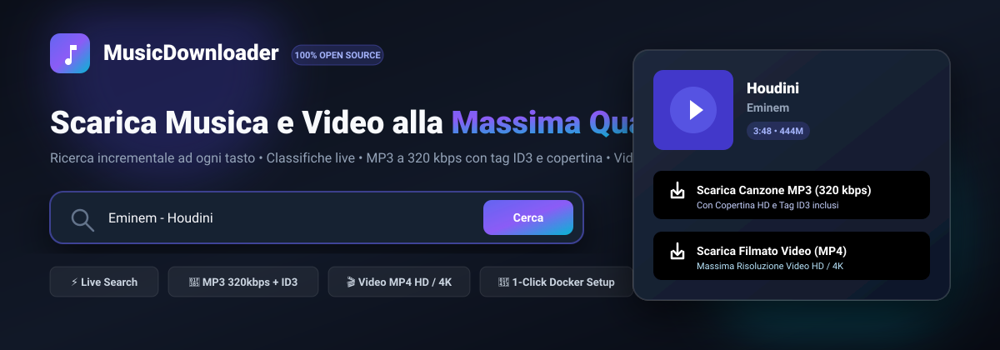
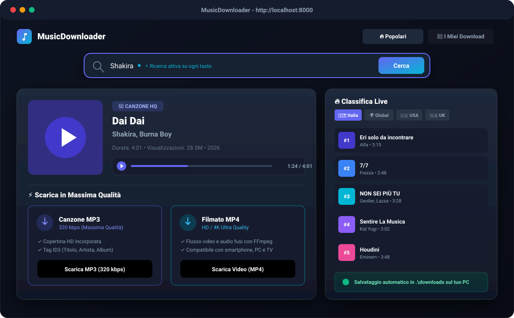
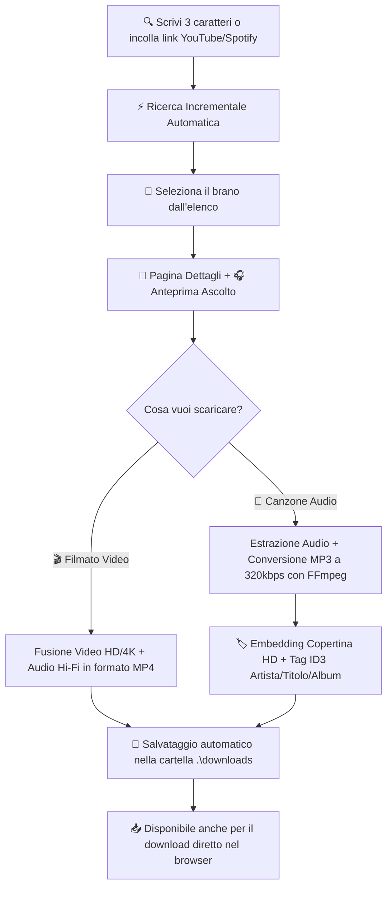

# 🎵 MusicDownloader - Docker App (100% Open Source)

<p align="center">
  
</p>

<p align="center">
  <strong>Applicazione Docker moderna, veloce e completamente Open Source per cercare, ascoltare in anteprima e scaricare musica e video da YouTube, YouTube Music e Spotify in massima qualità (MP3 320 kbps / Video MP4 HD & 4K).</strong>
</p>

<p align="center">
  
  
  
  
  
  
  
</p>

---

## 📸 Anteprima Interfaccia

<p align="center">
  
</p>

---

## 🌟 Caratteristiche Principali

- 🌐 **100% Open Source & Zero Dipendenze Esterne**: Non richiede account premium, chiavi API o login su servizi esterni. Tutto gira nel tuo container locale.
- ⚡ **Ricerca Incrementale (Live Search)**:
  - Inizia a cercare in tempo reale ad ogni tasto non appena scrivi **almeno 3 caratteri**.
  - Debounce fluido di 320ms con annullamento intelligente delle chiamate superate (`AbortController`).
  - Se cancelli il testo con la tastiera o premi la `✕`, l'app **torna automaticamente e fluidamente alla home dei brani popolari**.
- 🔗 **Supporto Link Diretti**:
  - Incolla direttamente link di **YouTube** (`https://youtube.com/watch?v=...`, `youtu.be`, YouTube Music).
  - Incolla direttamente link di **Spotify** (`https://open.spotify.com/track/...`): i metadati del brano vengono risolti automaticamente in locale via oEmbed senza bisogno di token Spotify e associati alla corrispondenza migliore.
- 🔥 **Classifiche e Canzoni Popolari in Tempo Reale**:
  - Selettore istantaneo per nazione: 🇮🇹 **Italia**, 🌍 **Globale**, 🇺🇸 **USA**, 🇬🇧 **UK**, 🇪🇸 **Spagna**.
  - Card moderne con copertina HD, titolo, artista, durata e badge di posizione (#1, #2, ...).
- 📄 **Pagina Dettagli Canzone Completa**:
  - Copertina ad altissima risoluzione con bagliore atmosferico.
  - Artista verificato, durata, visualizzazioni, data di uscita e album.
  - **Player di Anteprima integrato**: ascolta o guarda il brano prima di scaricarlo con sincronizzazione perfetta dello stato (pronto al primo clic).
- 🎵 **Download Audio MP3 (Massima Qualità 320 kbps)**:
  - Estrazione del flusso audio migliore disponibile.
  - Conversione ad alta fedeltà a **320 kbps con FFmpeg**.
  - **Copertina HD incorporata** direttamente nel file MP3 (tag ID3v2 APIC).
  - **Tag ID3 completi** (Titolo, Artista, Album) per una visualizzazione perfetta su autoradio, iPhone, Android e lettori MP3.
- 🎬 **Download Video MP4 con Rilevamento Intelligente del Videoclip Ufficiale**:
  - Risolve il problema dei brani YouTube Music / Topic / Spotify: anziché scaricare un'immagine statica con audio, il motore **individua automaticamente il vero videoclip musicale ufficiale in HD / 4K**!
  - Fusione con FFmpeg del flusso video a massima risoluzione (1080p, 1440p, 4K) e della traccia audio ad alta fedeltà.
  - File MP4 universale compatibile con PC, Smart TV e smartphone.
- 📥 **Pannello Globale Persistente dei Download (Drawer fluttuante)**:
  - Tutti i download rimangono sempre visibili e monitorabili in tempo reale tramite un pratico cassetto fluttuante e un badge animato nella barra di navigazione.
  - Puoi navigare tra le pagine, cercare altre canzoni o esplorare le classifiche: **i download continuano fluidamente in background senza interrompersi mai**.
- ⏯️ **Controllo Totale del Download (Pausa, Ripresa, Annullamento & Pulizia)**:
  - **Pausa**: sospendi qualsiasi download in corso salvaguardando i byte scaricati fino a quel momento.
  - **Ripresa dal punto esatto**: riparti istantaneamente dal punto e byte in cui era stato interrotto senza riscaricare tutto da capo.
  - **Annulla & Libera Memoria**: interrompe il processo e rimuove automaticamente i file temporanei `.part`, liberando subito memoria RAM e spazio disco.
- 📁 **Salvataggio Automatico sul Computer & Download nel Browser**:
  - Tutti i file scaricati finiscono istantaneamente nella cartella locale `./downloads` del tuo computer grazie al volume montato in Docker.
  - Pulsante per il download diretto nel browser se accedi da smartphone o altri dispositivi connessi alla rete locale.
- 📂 **Gestore "I Miei Download" & Svuotamento Rapido**:
  - Visualizza tutti i file scaricati con dimensione e data.
  - Eliminazione sicura di singoli brani anche con apostrofi e caratteri speciali nel nome.
  - Pulsante **"Svuota Cartella"** per eliminare l'intero archivio con un click.

---

## 📥 Guida al Download: Come Funziona Passo-Passo



---

## 🏠 Installazione e Avvio

### 1. Installazione su CasaOS (Home Server / NAS) 🏠

#### Metodo 1: Dall'interfaccia web di CasaOS (Consigliato - 1 Click)

1. Nella dashboard di CasaOS, clicca sul pulsante **"+"** (in alto a destra nella sezione App) e seleziona **"Installa un'applicazione personalizzata"** (*Install a customized app*).
2. In alto a destra della finestra, clicca sull'icona **"Importa"** (`</>` o icona file).
3. Incolla il seguente codice Docker Compose completo:

```yaml
name: musicdownloader
services:
  musicdownloader:
    image: ghcr.io/pitstop13/musicdownloader:latest
    container_name: musicdownloader-app
    ports:
      - "8765:8765"
    volumes:
      # Cartella sul tuo NAS/Server dove memorizzare i download musicali e video
      - /DATA/Media/Music:/app/downloads
    environment:
      - PYTHONUNBUFFERED=1
      - DOWNLOADS_DIR=/app/downloads
      - PORT=8765
    restart: unless-stopped
    x-casaos:
      ports:
        - container: "8765"
          description:
            en_us: Porta interfaccia Web MusicDownloader
            it_it: Porta interfaccia Web MusicDownloader
      volumes:
        - container: /app/downloads
          description:
            en_us: Cartella download brani MP3 e video MP4
            it_it: Cartella download brani MP3 e video MP4
x-casaos:
  architectures:
    - amd64
    - arm64
    - arm
  main: musicdownloader
  description:
    en_us: Modern web interface to search, preview, and download music (320kbps MP3 with embedded ID3 tags & cover art) and videos (HD/4K MP4) from YouTube, YouTube Music, and Spotify.
    it_it: Interfaccia web moderna per cercare, ascoltare e scaricare musica (MP3 a 320 kbps con tag ID3 e copertina) e video (MP4 HD/4K) da YouTube, YouTube Music e Spotify.
  tagline:
    en_us: Music & Video Downloader
    it_it: Downloader Musica & Video
  developer: MusicDownloader
  author: PitStop13
  icon: https://raw.githubusercontent.com/PitStop13/MusicDownloader/main/assets/logo.png
  thumbnail: https://raw.githubusercontent.com/PitStop13/MusicDownloader/main/assets/logo.png
  title:
    en_us: MusicDownloader
    it_it: MusicDownloader
  index: /
  port_map: "8765"
```

4. Clicca su **"Invia"** (*Submit*). I parametri principali, l'icona ufficiale, il titolo e la porta risulteranno **già tutti precompilati automaticamente**.
5. Clicca su **"Installa"** e attendi il download dell'immagine pubblicata da GitHub Container Registry.
6. Apri MusicDownloader cliccando sulla sua icona o collegandoti a: 👉 **`http://<IP-DEL-TUO-SERVER>:8765`**

#### Metodo 2: Da Terminale o SSH (Server / NAS)
```bash
cd /DATA/AppData
git clone https://github.com/PitStop13/MusicDownloader.git
cd MusicDownloader
docker compose up -d
```

---

### 2. Con 1 Click su Windows
Fai doppio clic sul file:
```cmd
start.bat
```
Lo script si occuperà di:
1. Verificare che Docker Desktop sia attivo (e avviarlo automaticamente se necessario);
2. Costruire e avviare il container in background;
3. Aprire il browser all'indirizzo **`http://localhost:8765`**.

---

### 3. Tramite Docker Compose (Windows / Mac / Linux)
Nel terminale della cartella del progetto:

```bash
docker compose up --build -d
```

Apri il browser su:
👉 **http://localhost:8765**

Per fermare il container:
```bash
docker compose down
```

---

### 4. Esecuzione Locale Senza Docker (Python)
Se preferisci eseguire l'app direttamente in Python sul tuo computer:

```bash
# 1. Installa i requisiti
pip install -r requirements.txt

# 2. Avvia l'applicazione
python run_local.py
```
*(Nota: per la conversione MP3 locale è consigliato avere `ffmpeg` installato nel PATH del sistema).*

---

## 🧪 Test Automatizzati

Il progetto include una suite di test end-to-end che valida l'intero flusso dell'applicazione:

```bash
python tests/test_suite.py
```

La suite verifica automaticamente:
1. ✅ Health check del backend (`/api/health`)
2. ✅ Caricamento della Single Page App (`GET /`)
3. ✅ Classifiche live Italia e Global (`/api/popular`)
4. ✅ Ricerca incrementale con debounce (`/api/search`)
5. ✅ Risoluzione automatica dei link Spotify oEmbed
6. ✅ Estrazione dettagli e qualità video 4K / audio 320kbps
7. ✅ Download MP3 a 320 kbps con verifica copertina ID3 e pulizia file
8. ✅ Download Video MP4 (4K/HD) con multiplexing FFmpeg, streaming e pulizia file

---

## 🏗️ Architettura del Progetto

```
MusicDownloader/
├── .github/
│   └── workflows/
│       └── docker-publish.yml # Build & pubblicazione automatica su GHCR (multi-arch amd64/arm64)
├── app/
│   ├── main.py                # Server FastAPI, endpoint REST e download stream
│   ├── downloader.py          # Pipeline yt-dlp, conversione FFmpeg a 320kbps e ID3 tagging
│   ├── music_service.py       # Classifiche YouTube Music live e risoluzione Spotify oEmbed
│   ├── templates/
│   │   └── index.html         # Single Page Application HTML5
│   └── static/
│       ├── css/
│       │   └── style.css      # Tema scuro moderno Glassmorphism
│       ├── js/
│       │   └── app.js         # Logica client, ricerca incrementale, player e progress bar
│       └── icons/
│           ├── logo.png       # Icona ufficiale alta risoluzione
│           └── logo.jpg
├── assets/                    # Logo PNG, banner SVG e anteprime grafiche per CasaOS
├── downloads/                 # Cartella volume montata sul tuo PC con i file scaricati
├── tests/
│   └── test_suite.py          # Suite di test automatizzati end-to-end (11 test)
├── Dockerfile                 # Immagine Debian con Python 3.11, FFmpeg e Node.js
├── docker-compose.yml         # Configurazione Docker Compose con schema x-casaos
├── docker-compose.template.yml# Template CasaOS per installazione rapida con 1-click
├── requirements.txt           # Dipendenze Python
├── start.bat                  # Avvio con 1-click per Windows
├── start.sh                   # Script di avvio per Linux / macOS
└── README.md                  # Documentazione ufficiale
```

---

## 📄 Licenza

Questo progetto è rilasciato sotto licenza Open Source **MIT**. Libero per uso personale, studio e modifiche.
