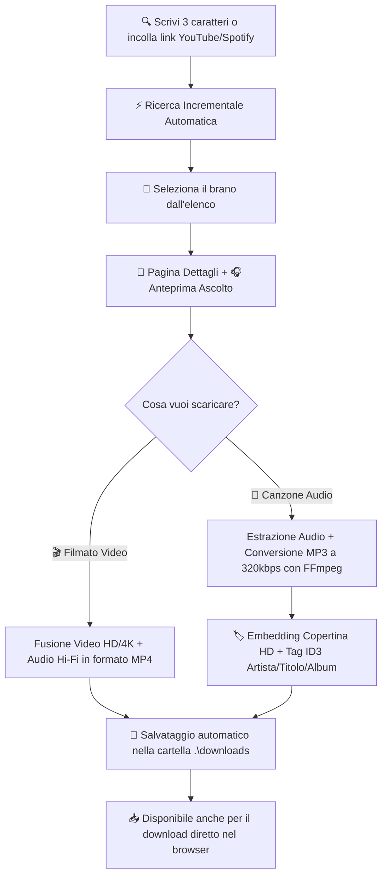

# 🎵 MusicDownloader - Docker App (100% Open Source)

<p align="center">
  
</p>

<p align="center">
  <strong>Applicazione Docker moderna, veloce e completamente Open Source per cercare, ascoltare in anteprima e scaricare musica e video da YouTube, YouTube Music e Spotify in massima qualità (MP3 320 kbps / Video MP4 HD & 4K).</strong>
</p>

<p align="center">
  
  
  
  
  
  
</p>

---

## 📸 Anteprima Interfaccia

<p align="center">
  
</p>

---

## 🌟 Caratteristiche Principali

- 🌐 **100% Open Source & Zero Dipendenze Esterne**: Non richiede account premium, chiavi API o login su servizi esterni. Tutto gira nel tuo container locale.
- ⚡ **Ricerca Incrementale (Live Search)**:
  - Inizia a cercare in tempo reale ad ogni tasto non appena scrivi **almeno 3 caratteri**.
  - Debounce fluido di 320ms con annullamento intelligente delle chiamate superate (`AbortController`).
  - Se cancelli il testo con la tastiera o premi la `✕`, l'app **torna automaticamente e fluidamente alla home dei brani popolari**.
- 🔗 **Supporto Link Diretti**:
  - Incolla direttamente link di **YouTube** (`https://youtube.com/watch?v=...`, `youtu.be`, YouTube Music).
  - Incolla direttamente link di **Spotify** (`https://open.spotify.com/track/...`): i metadati del brano vengono risolti automaticamente in locale via oEmbed senza bisogno di token Spotify e associati alla corrispondenza migliore.
- 🔥 **Classifiche e Canzoni Popolari in Tempo Reale**:
  - Selettore istantaneo per nazione: 🇮🇹 **Italia**, 🌍 **Globale**, 🇺🇸 **USA**, 🇬🇧 **UK**, 🇪🇸 **Spagna**.
  - Card moderne con copertina HD, titolo, artista, durata e badge di posizione (#1, #2, ...).
- 📄 **Pagina Dettagli Canzone Completa**:
  - Copertina ad altissima risoluzione con bagliore atmosferico.
  - Artista verificato, durata, visualizzazioni, data di uscita e album.
  - **Player di Anteprima integrato**: ascolta o guarda il brano prima di scaricarlo con sincronizzazione perfetta dello stato (pronto al primo clic).
- 🎵 **Download Audio MP3 (Massima Qualità 320 kbps)**:
  - Estrazione del flusso audio migliore disponibile.
  - Conversione ad alta fedeltà a **320 kbps con FFmpeg**.
  - **Copertina HD incorporata** direttamente nel file MP3 (tag ID3v2 APIC).
  - **Tag ID3 completi** (Titolo, Artista, Album) per una visualizzazione perfetta su autoradio, iPhone, Android e lettori MP3.
- 🎬 **Download Video MP4 (Massima Risoluzione HD / 4K)**:
  - Fusione con FFmpeg del flusso video a massima risoluzione (1080p, 1440p, 4K) e della traccia audio ad alta fedeltà.
  - File MP4 universale compatibile con PC, Smart TV e smartphone.
- 📁 **Salvataggio Automatico sul Computer & Download nel Browser**:
  - Tutti i file scaricati finiscono istantaneamente nella cartella locale `./downloads` del tuo computer grazie al volume montato in Docker.
  - Pulsante per il download diretto nel browser se accedi da smartphone o altri dispositivi connessi alla rete locale.
- 📂 **Gestore "I Miei Download"**:
  - Visualizza tutti i file scaricati con dimensione e data, riproducili ed eliminali con un click.

---

## 📥 Guida al Download: Come Funziona Passo-Passo



### 1. Ricerca del Brano
Scrivi almeno 3 lettere nella barra di ricerca in alto (es. `Coldplay` o `Alfa`). Non serve premere Invio o cliccare bottoni: i risultati compaiono immediatamente a schermo.

### 2. Apertura dei Dettagli
Clicca sulla card della canzone per aprire la pagina dettagli: qui puoi cliccare su **"Ascolta Anteprima"** per ascoltare la canzone.

### 3. Scelta del Formato di Download
- **Bottone Viola (Audio MP3)**: Estrae l'audio, lo codifica a 320 kbps con FFmpeg e applica i tag ID3 con la copertina inclusa nel file.
- **Bottone Azzurro (Video MP4)**: Scarica il video alla massima risoluzione supportata (fino a 4K) con l'audio sincronizzato.

### 4. Dove si trova il file scaricato?
Il file viene salvato immediatamente:
- Nella cartella **`downloads/`** presente all'interno del progetto sul tuo PC;
- Nel tuo browser, cliccando sul pulsante verde **"Scarica subito nel browser"**.

---

## 🚀 Avvio Rapido

### Opzione 1: Con 1 Click su Windows (Consigliata)
Fai doppio clic sul file:
```cmd
start.bat
```
Lo script si occuperà di:
1. Verificare che Docker Desktop sia attivo (e avviarlo automaticamente se necessario);
2. Costruire e avviare il container in background;
3. Aprire il browser all'indirizzo **`http://localhost:8765`**.

---

### Opzione 2: Tramite Docker Compose (Windows / Mac / Linux)
Nel terminale della cartella del progetto:

```bash
# Avvia il container in background
docker compose up --build -d
```

Apri il browser su:
👉 **http://localhost:8765**

Per fermare il container:
```bash
docker compose down
```

---

### Opzione 3: Installazione su CasaOS 🏠
Puoi aggiungere facilmente **MusicDownloader** alla tua dashboard di CasaOS come app personalizzata (o importando direttamente il `docker-compose.yml`):

1. Su CasaOS, apri l'**App Store** e clicca su **Custom Install** (in alto a destra).
2. Compila i campi della schermata:
   - **App Name**: `MusicDownloader`
   - **Icon URL**:
     ```text
     https://raw.githubusercontent.com/PitStop13/MusicDownloader/main/assets/logo.png
     ```
     *(oppure in locale: `http://[IP-DEL-TUO-SERVER]:8765/static/icons/logo.png`)*
   - **Porta Web UI**: `8765`
   - **Porta Container**: `8765` -> **Porta Host**: `8765`
   - **Volume Host**: `/DATA/Media/Music` (o la cartella che preferisci) -> **Container**: `/app/downloads`
3. Clicca su **Submit / Salva**: l'icona ufficiale apparirà subito nella dashboard di CasaOS!

---

### Opzione 4: Esecuzione Locale Senza Docker (Python)
Se preferisci eseguire l'app direttamente in Python sul tuo computer:

```bash
# 1. Installa i requisiti
pip install -r requirements.txt

# 2. Avvia l'applicazione
python run_local.py
```
*(Nota: per la conversione MP3 locale è consigliato avere `ffmpeg` installato nel PATH del sistema).*

---

## 🧪 Test Automatizzati

Il progetto include una suite di test end-to-end che valida l'intero flusso dell'applicazione:

```bash
python tests/test_suite.py
```

La suite verifica automaticamente:
1. ✅ Health check del backend (`/api/health`)
2. ✅ Caricamento della Single Page App (`GET /`)
3. ✅ Classifiche live Italia e Global (`/api/popular`)
4. ✅ Ricerca incrementale con debounce (`/api/search`)
5. ✅ Risoluzione automatica dei link Spotify oEmbed
6. ✅ Estrazione dettagli e qualità video 4K / audio 320kbps
7. ✅ Download MP3 a 320 kbps con verifica copertina ID3 e pulizia file
8. ✅ Download Video MP4 (4K/HD) con multiplexing FFmpeg, streaming e pulizia file

---

## 🏗️ Architettura del Progetto

```
MusicDownloader/
├── app/
│   ├── main.py              # Server FastAPI, endpoint REST e download stream
│   ├── downloader.py        # Pipeline yt-dlp, conversione FFmpeg a 320kbps e ID3 tagging
│   ├── music_service.py     # Classifiche YouTube Music live e risoluzione Spotify oEmbed
│   ├── templates/
│   │   └── index.html       # Single Page Application HTML5
│   └── static/
│       ├── css/
│       │   └── style.css    # Tema scuro moderno Glassmorphism
│       ├── js/
│       │   └── app.js       # Logica client, ricerca incrementale, player e progress bar
│       └── icons/
├── assets/                  # Banner SVG e anteprime grafiche
├── downloads/               # Cartella volume montata sul tuo PC con i file scaricati
├── tests/
│   └── test_suite.py        # Suite di test automatizzati end-to-end
├── Dockerfile               # Immagine Debian con Python 3.11, FFmpeg e Node.js
├── docker-compose.yml       # Configurazione Docker Compose con volume persistente
├── requirements.txt         # Dipendenze Python
├── start.bat                # Avvio con 1-click per Windows
├── start.sh                 # Script di avvio per Linux / macOS
└── README.md                # Documentazione ufficiale
```

---

## 📄 Licenza

Questo progetto è rilasciato sotto licenza Open Source **MIT**. Libero per uso personale, studio e modifiche.
